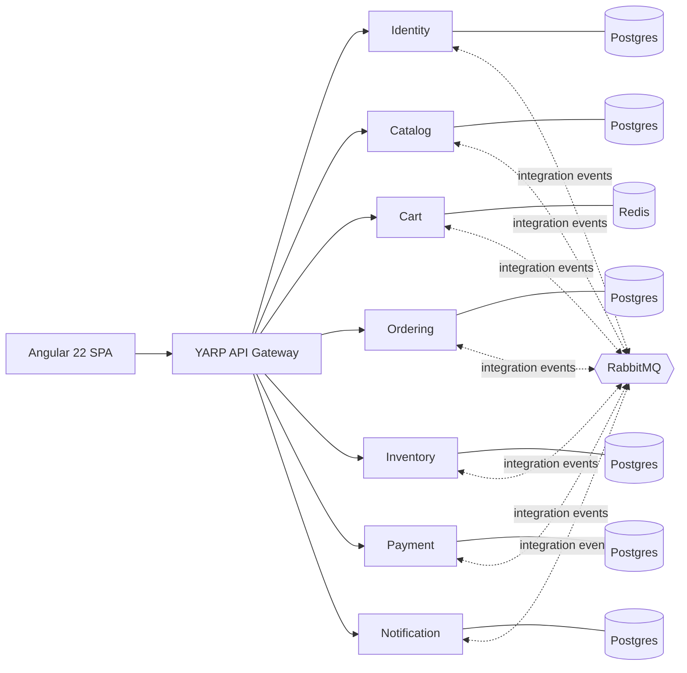
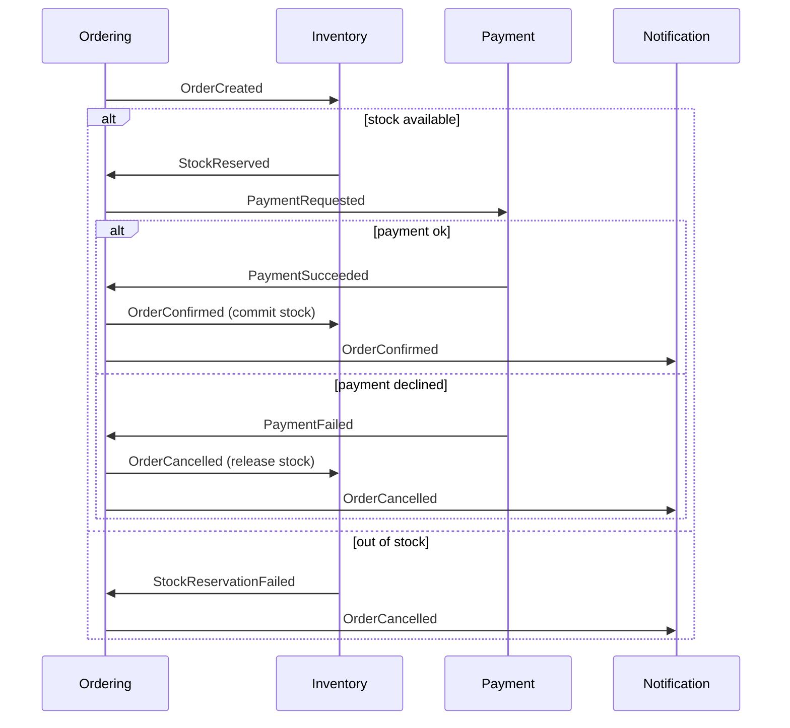

# ShopSphere

An event-driven e-commerce platform built as a microservices showcase: **.NET 10**, **RabbitMQ**, **PostgreSQL**, **Redis**, **YARP** gateway and an **Angular 22** storefront (Tailwind CSS 4, shadcn-style components).

Each service follows **Domain-Driven Design** with a **Clean Architecture** layout, and the order flow is a **choreographed saga** over RabbitMQ with a transactional outbox and idempotent consumers.

## Architecture



| Service | Responsibility | Store |
|---|---|---|
| Identity | Register, login, JWT issuing, roles | Postgres |
| Catalog | Products, categories, search, filters, sorting | Postgres |
| Cart | Per-user shopping cart | Redis |
| Ordering | Order aggregate and saga state | Postgres |
| Inventory | Stock levels and reservations | Postgres |
| Payment | Payment attempts (simulated gateway) | Postgres |
| Notification | Emails (logged) and in-app notifications | Postgres |

### Order saga



Reliability patterns: **transactional outbox** (events are saved with the aggregate, a dispatcher publishes them), **inbox deduplication** (consumers are idempotent), **dead-letter queues** for poison messages, and publisher confirms.

### Layout of each service

```
src/Services/<Service>/
  ShopSphere.<Service>.Domain          aggregates, value objects, domain events (no dependencies)
  ShopSphere.<Service>.Application     CQRS commands/queries (MediatR), validators, integration handlers
  ShopSphere.<Service>.Infrastructure  EF Core, repositories, external adapters
  ShopSphere.<Service>.Api             minimal-API endpoints, DI composition root
src/BuildingBlocks                     shared kernel, MediatR pipeline behaviours, RabbitMQ event bus, outbox/inbox
```

Dependencies point inward only. This is enforced by architecture tests (NetArchTest).

## Run it

```bash
docker compose up --build
```

- Storefront: http://localhost:4200
- API gateway: http://localhost:8080
- RabbitMQ UI: http://localhost:15672 (guest / guest)

Create an account, add products to the cart and check out. The orders page shows the saga progressing live. In the simulated payment gateway, a total ending in `.99` is declined so you can see the compensation path.

### Develop without Docker for the SPA

```bash
cd web && npm install && npm start   # proxies /api to http://localhost:8080
```

## Tests

```bash
dotnet test ShopSphere.sln          # domain, saga/application and architecture tests
cd web && npx ng test --no-watch    # Angular unit tests (Vitest)
```

## Tech notes

- .NET 10, C# latest, EF Core 10, FluentValidation 12, RabbitMQ.Client 7 (async API).
- MediatR is pinned to 12.5.0 and FluentAssertions to 7.2.0: later major versions need a commercial licence, and this repo uses free tooling only.
- UI components follow the shadcn/ui approach (copy-in components using Tailwind tokens and class-variance-authority) rather than a component library dependency.

## Roadmap

Admin dashboard, Testcontainers integration tests, OpenTelemetry tracing, Kubernetes manifests.

## License

MIT
